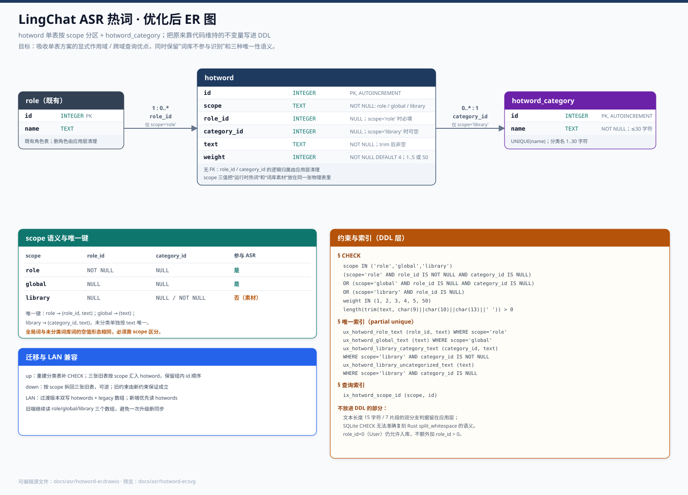

# ASR 热词存储 v2：单表 + 显式 scope

> 状态：已落库。ER 图见 [hotword-er.svg](hotword-er.svg)，可编辑源文件见 [hotword-er.drawio](hotword-er.drawio)。

## 1. 结论

采用**两张表**：`hotword` 单表按 `scope` 分区，`hotword_category` 独立。

吸收对方方案的可取点：

- 作用域显式化，不再靠三张表名隐含
- 跨作用域查询、导出、统计只需要一条 `WHERE`
- 实体与仓储样板从三套收敛成一套
- 新增作用域时只需增加 `scope` 值与对应约束，不必再加表

同时保留原设计的关键不变量：

- 词库是素材，不参与识别
- 角色热词、全局热词、词库词条各自独立
- 同一词条可以同时存在于多个词库分类
- 不建外键，级联清理仍由应用层负责

**对外命令、DTO、前端组件不变。** 改动集中在实体、仓储、迁移、LAN payload。

## 2. 表结构

### 2.1 `hotword`

```sql
CREATE TABLE hotword (
    id          INTEGER NOT NULL PRIMARY KEY AUTOINCREMENT,
    scope       TEXT    NOT NULL,
    role_id     INTEGER,
    category_id INTEGER,
    text        TEXT    NOT NULL,
    weight      INTEGER NOT NULL DEFAULT 4,

    CHECK (scope IN ('role', 'global', 'library')),

    CHECK (
        (scope = 'role'
            AND role_id IS NOT NULL
            AND category_id IS NULL)
        OR
        (scope = 'global'
            AND role_id IS NULL
            AND category_id IS NULL)
        OR
        (scope = 'library'
            AND role_id IS NULL
            AND (category_id IS NULL OR category_id > 0))
    ),

    CHECK (weight IN (1, 2, 3, 4, 5, 50)),
    CHECK (length(trim(text, char(9) || char(10) || char(13) || ' ')) > 0)
);
```

列说明：

| 列            | 含义                                                          |
| ------------- | ------------------------------------------------------------- |
| `scope`       | `role` / `global` / `library`。只表示存储作用域，不表示词义   |
| `role_id`     | 仅 `scope='role'` 非空；逻辑上指向 `role.id`                  |
| `category_id` | 仅 `scope='library'` 可非空；逻辑上指向 `hotword_category.id` |
| `text`        | 词条正文；唯一键的比较对象                                    |
| `weight`      | `1..5` 普通档，`50` 超级档                                    |

`role_id = 0`（User）仍允许入库。它与 `global` 的区分靠 `scope`，不靠 `role_id` 是否为正。

### 2.2 `hotword_category`

```sql
CREATE TABLE hotword_category (
    id   INTEGER NOT NULL PRIMARY KEY AUTOINCREMENT,
    name TEXT    NOT NULL,
    UNIQUE (name),
    CHECK (length(trim(name, char(9) || char(10) || char(13) || ' ')) BETWEEN 1 AND 30)
);
```

分类名仍由应用层做 Unicode `trim` 与空值校验；DDL 只兜底 ASCII 空白与长度。

### 2.3 scope 语义

| scope     | role_id    | category_id         | 参与 ASR | 唯一键                                    |
| --------- | ---------- | ------------------- | -------- | ----------------------------------------- |
| `role`    | `NOT NULL` | `NULL`              | 是       | `(role_id, text)`                         |
| `global`  | `NULL`     | `NULL`              | 是       | `(text)`                                  |
| `library` | `NULL`     | `NULL` / `NOT NULL` | 否       | `(category_id, text)` / 未分类按 `(text)` |

**为什么不用单一的 `owner_id`**：`role_id` 与 `category_id` 的参照对象不同，合成一列后无法表达分类内唯一，也无法在 DDL 里约束“角色词不能带分类”。两个可空列换来的是可写的 `CHECK` 与可用的部分索引。

**为什么还保留 `hotword_category`**：分类名是独立实体，需要 `UNIQUE(name)` 与长度约束；把分类名重复到每条词上会带来改名风暴与更复杂的唯一性。

**为什么仍然不建外键**：沿用现有约定。LAN 镜像在单个事务内执行，事务内 `PRAGMA foreign_keys = OFF` 是 no-op；统一不写 FK，级联清理落在应用层。详见 [README 的 3.10](README.md#310-数据模型细节无外键)。

## 3. 约束

### 3.1 CHECK

| 约束                                                         | 作用                                                     |
| ------------------------------------------------------------ | -------------------------------------------------------- |
| `scope IN ('role','global','library')`                       | 限定作用域取值，阻止拼写错误进入库                       |
| `scope` / `role_id` / `category_id` 的联合 `CHECK`（三分支） | 阻止非法组合：角色词无角色、全局词带归属、词库词带角色等 |
| `weight IN (1,2,3,4,5,50)`                                   | 把权重离散域写死；`6..49` 不再允许落库                   |
| `length(trim(text, ...)) > 0`                                | 阻止空串与纯 ASCII 空白                                  |
| `hotword_category.name` 的 `BETWEEN 1 AND 30`                | 分类名非空且不超过 30 字符                               |

### 3.2 唯一索引

```sql
CREATE UNIQUE INDEX ux_hotword_role_text
    ON hotword (role_id, text)
    WHERE scope = 'role';

CREATE UNIQUE INDEX ux_hotword_global_text
    ON hotword (text)
    WHERE scope = 'global';

CREATE UNIQUE INDEX ux_hotword_library_category_text
    ON hotword (category_id, text)
    WHERE scope = 'library' AND category_id IS NOT NULL;

CREATE UNIQUE INDEX ux_hotword_library_uncategorized_text
    ON hotword (text)
    WHERE scope = 'library' AND category_id IS NULL;
```

四条都是**部分唯一索引**。原因：

- 角色唯一性只在 `scope='role'` 内成立，不能约束到全局或词库
- 全局唯一性只在 `scope='global'` 内成立
- 词库已分类与未分类的空值形态不同；SQLite 的复合唯一索引对 `NULL` 不生效，未分类必须单独建一条
- 同一词条可以同时存在于两个分类，因此不能做全局 `UNIQUE(text)`

**全局词与未分类词库词的空值形态相同**（`role_id`、`category_id` 都是 `NULL`），只能靠 `scope` 区分。这是单表方案最需要小心的地方，也是 `scope` 不能省的原因。

### 3.3 查询索引

```sql
CREATE INDEX ix_hotword_scope_id ON hotword (scope, id);
```

- 运行时按 `scope='role' AND role_id IN (...)` 读取：`ux_hotword_role_text` 的最左前缀 `role_id` 负责过滤，排序量很小
- 全局 / 词库按 `scope` 读取：`ix_hotword_scope_id` 覆盖过滤与 `ORDER BY id`
- 词库最多 2000 条，不额外为 `category_id` 建索引

### 3.4 留在应用层的校验

以下规则不放进 DDL，避免 SQLite 与 Rust 语义不一致：

- **文本长度双判据**：含非 ASCII 时 ≤15 字符；纯 ASCII 时按 `split_whitespace` 片段数 ≤7。SQLite `CHECK` 无法准确复刻 `split_whitespace`，硬写会误伤合法数据。
- **Unicode `trim`**：DDL 只 trim ASCII 空白；Rust 侧仍用 `validate_and_trim` 处理全部 Unicode 空白。
- **条数上限**：角色/全局各 200 条、词库 2000 条、分类 100 个。这是业务上限，不是单行约束。
- **悬空 `category_id`**：读侧继续把未知 id 归为未分类；词库整表替换会重建分类与词条，不依赖 FK。
- **分类名重复**：DDL 的 `UNIQUE(name)` 是 BINARY 精确比较；应用层先 `trim` 再比较，保持原口径。

### 3.5 不变量覆盖

| 不变量         | 旧设计                      | 新设计                                                                                  |
| -------------- | --------------------------- | --------------------------------------------------------------------------------------- |
| 词库不参与识别 | 独立表，查询天然隔离        | `scope='library'` + 仓储只暴露 `list_by_role`/`list_global`；补“场景查询不返回词库”测试 |
| 角色词不串角色 | 表 + `UNIQUE(role_id,text)` | 部分唯一索引 + 仓储固定 `scope='role'` 过滤                                             |
| 同一词跨分类   | 两表 + 两条部分唯一索引     | `(category_id,text)` 部分唯一索引                                                       |
| 全局词唯一     | `UNIQUE(text)`              | `WHERE scope='global'` 的部分唯一索引                                                   |
| 删角色清理热词 | 应用层 DELETE               | 应用层 `DELETE ... WHERE scope='role' AND role_id=?`                                    |
| 归档不带走热词 | 导出清单不含热词表          | 导出清单不含 `hotword`；补归档测试                                                      |
| LAN 旧设备兼容 | 四数组 + `serde(default)`   | 直接切断旧端，旧设备不兼容，见 4.4                                                      |

## 4. 迁移

### 4.1 Up

迁移名建议：`m20261114_000001_unify_hotword_table.rs`，追加在 `m20261030_000002` 之后。

```sql
BEGIN;

-- 分类表重建：补非空/长度 CHECK，保留原 id（library 行仍按 id 引用）
CREATE TABLE hotword_category_new (
    id   INTEGER NOT NULL PRIMARY KEY AUTOINCREMENT,
    name TEXT    NOT NULL,
    UNIQUE (name),
    CHECK (length(trim(name, char(9) || char(10) || char(13) || ' ')) BETWEEN 1 AND 30)
);
INSERT INTO hotword_category_new (id, name) SELECT id, name FROM hotword_category;
DROP TABLE hotword_category;
ALTER TABLE hotword_category_new RENAME TO hotword_category;

CREATE TABLE hotword (
    id          INTEGER NOT NULL PRIMARY KEY AUTOINCREMENT,
    scope       TEXT    NOT NULL,
    role_id     INTEGER,
    category_id INTEGER,
    text        TEXT    NOT NULL,
    weight      INTEGER NOT NULL DEFAULT 4,
    CHECK (scope IN ('role', 'global', 'library')),
    CHECK (
        (scope = 'role'    AND role_id IS NOT NULL AND category_id IS NULL)
        OR (scope = 'global'  AND role_id IS NULL     AND category_id IS NULL)
        OR (scope = 'library' AND role_id IS NULL
            AND (category_id IS NULL OR category_id > 0))
    ),
    CHECK (weight IN (1, 2, 3, 4, 5, 50)),
    CHECK (length(trim(text, char(9) || char(10) || char(13) || ' ')) > 0)
);

INSERT INTO hotword (scope, role_id, category_id, text, weight)
    SELECT 'role', role_id, NULL, text, MAX(weight)
    FROM (
        SELECT id, role_id,
               trim(text, char(9) || char(10) || char(13) || ' ') AS text,
               CASE WHEN weight BETWEEN 1 AND 5 THEN weight
                    WHEN weight >= 50 THEN 50
                    ELSE 5 END AS weight
        FROM role_hotword
        WHERE length(trim(text, char(9) || char(10) || char(13) || ' ')) > 0
    )
    GROUP BY role_id, text
    ORDER BY MIN(id);

INSERT INTO hotword (scope, role_id, category_id, text, weight)
    SELECT 'global', NULL, NULL, text, MAX(weight)
    FROM (
        SELECT id,
               trim(text, char(9) || char(10) || char(13) || ' ') AS text,
               CASE WHEN weight BETWEEN 1 AND 5 THEN weight
                    WHEN weight >= 50 THEN 50
                    ELSE 5 END AS weight
        FROM global_hotword
        WHERE length(trim(text, char(9) || char(10) || char(13) || ' ')) > 0
    )
    GROUP BY text
    ORDER BY MIN(id);

INSERT INTO hotword (scope, role_id, category_id, text, weight)
    SELECT 'library', NULL, category_id, text, MAX(weight)
    FROM (
        SELECT id, category_id,
               trim(text, char(9) || char(10) || char(13) || ' ') AS text,
               CASE WHEN weight BETWEEN 1 AND 5 THEN weight
                    WHEN weight >= 50 THEN 50
                    ELSE 5 END AS weight
        FROM library_hotword
        WHERE length(trim(text, char(9) || char(10) || char(13) || ' ')) > 0
    )
    GROUP BY category_id, text
    ORDER BY MIN(id);

DROP TABLE role_hotword;
DROP TABLE global_hotword;
DROP TABLE library_hotword;

CREATE UNIQUE INDEX ux_hotword_role_text ON hotword (role_id, text) WHERE scope = 'role';
CREATE UNIQUE INDEX ux_hotword_global_text ON hotword (text) WHERE scope = 'global';
CREATE UNIQUE INDEX ux_hotword_library_category_text ON hotword (category_id, text)
    WHERE scope = 'library' AND category_id IS NOT NULL;
CREATE UNIQUE INDEX ux_hotword_library_uncategorized_text ON hotword (text)
    WHERE scope = 'library' AND category_id IS NULL;
CREATE INDEX ix_hotword_scope_id ON hotword (scope, id);

COMMIT;
```

要点：

- **迁移前按新唯一键去重**：`GROUP BY` + `MAX(weight)`。旧库里如果存在“张三”与“张三 ”这种仅空白不同的行，新唯一索引会冲突；迁移时保留首现行、取最大权重。
- **保留组内插入顺序**：每个作用域 `ORDER BY MIN(id)`，迁移后 `ORDER BY id` 的顺序与旧表一致。
- **不保留原 id**：三张旧表的 id 各自独立，无法在单表里同时保留；没有任何外部引用依赖词条 id。
- **分类表重建**：`hotword_category` 也补上非空/长度 CHECK；保留原 id，避免词库行的 `category_id` 悬空。旧分类名若为空或超长，迁移会因 CHECK 失败而中止，需先人工修正。
- **权重先归一**：`6..49` 降为 5，`>=50` 归 50，避免新 `CHECK` 让整条迁移失败。
- **空行过滤**：纯 ASCII 空白的行直接丢弃；应用层本来也不允许保存。
- **事务包裹 DDL**：SQLite 的 DDL 逐条提交，中途失败会留下半成品；沿用 `m20261023` 的 `BEGIN/COMMIT` 写法。

### 4.2 Down

与 up 对称：按 `scope` 拆回 `role_hotword`、`global_hotword`、`library_hotword`，重建旧唯一约束，最后 `DROP TABLE hotword`。`hotword_category` 保留不动。

旧约束比新约束宽松，因此新表的数据必然满足旧表：

- `hotword` 的角色唯一索引保证 `UNIQUE(role_id, text)`
- 全局唯一索引保证 `UNIQUE(text)`
- 词库两条部分索引保证旧词库的两条唯一索引

### 4.3 迁移顺序与备份

1. 启动前备份 `game_database.db`
2. 在数据库副本上跑 `up`，核对三组数量与抽样顺序
3. 跑 `down`，确认旧表可读
4. 再对真实库执行 `up`
5. 应用启动时 SeaORM 自动记账；迁移失败则整库回滚

### 4.4 LAN 兼容

**最终决策：直接切断旧端，不做双写过渡，也不引入 `schema_version` 回退。**

`DbRecords` 删除 `role_hotwords` / `global_hotwords` / `library_hotwords`，只保留
`hotwords` 单表数组。旧版本设备只认识三个旧数组，与新版本设备同步时会被视为没有热词，
热词按空表镜像——这是可接受的代价，前提是**所有设备一起升级**。

不做过渡版本的理由：双写与 `schema_version` 会在导入侧长期保留两套形状与分支，而 LAN 同步
是同一用户的设备间镜像，设备数量有限、升级能同步完成；为一段短过渡期维护双写不划算。

导入侧仍保留逐行归一：`weight` 归一、`text` trim、`scope`/归属一致性校验，坏行只丢该行并记 warn，不让一行坏数据拖垮整批镜像。

## 5. 代码改造清单

| 层       | 文件                                                        | 改动                                                                                                                             |
| -------- | ----------------------------------------------------------- | -------------------------------------------------------------------------------------------------------------------------------- |
| 实体     | `db/entities/hotword.rs`（新增）                            | 单表模型；`HotwordScope` 枚举，`serde(rename_all = "lowercase")`                                                                 |
| 实体     | `db/entities/{role,global,library}_hotword.rs`              | 删除；更新 `entities/mod.rs`                                                                                                     |
| 仓储     | `db/managers/hotword_repo.rs`                               | 保留 `list_by_role` / `list_by_roles` / `list_global` / `list_library` / `replace_*` 的签名；内部固定 scope；新增 scope 隔离测试 |
| 命令层   | `api/hotword.rs`                                            | DTO 与 `#[tauri::command]` 不变；只改 Model 转换与导入                                                                           |
| 角色删除 | `db/managers/role_repo.rs`                                  | 删除热词改为 `scope='role' AND role_id=?`                                                                                        |
| LAN 消息 | `lan_sync/messages.rs`                                      | 改为 `hotwords` 单表数组，删除三个旧数组字段                                                                                     |
| LAN 同步 | `lan_sync/db_sync.rs`                                       | 导出 / 导入 `hotwords` 单表；`DELETE_ORDER` 改为 `hotword` → `hotword_category`                                                  |
| 迁移     | `migration/m20261114_000001_unify_hotword_table.rs`（新增） | up/down 见第 4 节；在 `migration/mod.rs` 追加注册                                                                                |
| 文档     | `docs/asr/README.md`                                        | 表数量、§3.8 镜像表清单、§3.10 无外键段落改为两张表                                                                              |
| 前端     | `src/api/services/hotword.ts`、热词组件                     | **预期零改动**；仅回归批量导入/删除与词库选择器                                                                                  |

仓储的公开方法保持原签名，是这次改造最重要的约束：命令层、前端草稿模型、批量导入/删除都不需要跟着改，风险集中在存储层。

## 6. 收益与代价

| 维度      | 收益                        | 代价                           |
| --------- | --------------------------- | ------------------------------ |
| 表数量    | 4 → 2                       | 单表出现可空多态归属列         |
| 实体/仓储 | 3 套 → 1 套                 | 查询必须始终带 scope 谓词      |
| 跨域操作  | 一条 `WHERE scope IN (...)` | 旧查询迁移时要逐条补 scope     |
| 唯一性    | 4 条部分唯一索引集中在一处  | 谓词比三张表上的简单约束更难读 |
| 扩展性    | 新增作用域加一个值          | 新作用域仍要补 CHECK 与索引    |
| 迁移      | down 可逆                   | 需要一次全量搬迁与 LAN 过渡    |

## 7. 验收

- `cargo test -p ling-chat-main --lib hotword`
  - 角色/全局/词库原有归并测试
  - 新增：角色 A/B 同词互不影响
  - 新增：全局与未分类词库同词可共存
  - 新增：词库跨分类同词、同分类归并
  - 新增：场景热词查询不返回 `scope='library'`
  - 新增：非法 scope/归属组合被拒
- `pnpm check:rs`
- `pnpm build`
- 迁移：
  - 在真实库副本上 up/down 各一次
  - 核对三组数量、组内顺序、权重归一
  - 构造“仅空白不同”的重复行，确认迁移能去重
- LAN：
  - 旧端 → 新端：旧端 payload 无 `hotwords`，热词按空表镜像
  - 新端 → 旧端：不支持，旧端不兼容
  - 新端 → 新端：`hotwords` 单表镜像
- 手工：
  - 角色热词、全局热词、词库的增删改与批量导入/删除
  - 删除角色后无孤儿热词
  - 角色归档导出/导入不携带热词

## 8. ER 图



可编辑源文件：[hotword-er.drawio](hotword-er.drawio)。项目内没有集成 Mermaid/PlantUML 渲染 CLI，现有图形资产使用 draw.io；这份 SVG 是按同一结构生成的预览。
